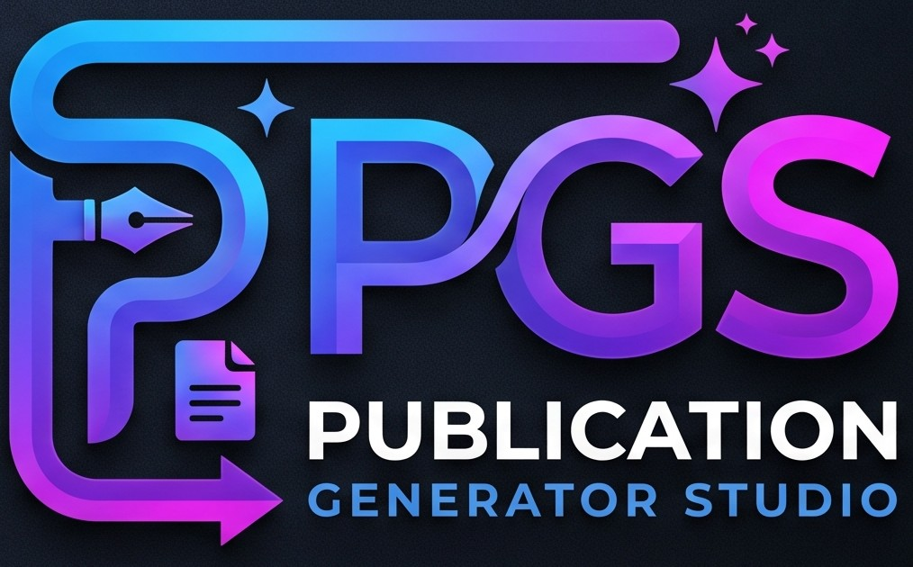

<p align="center">
  
</p>

<h1 align="center">Publication Generator Studio (PGS)</h1>

<p align="center">
  <b>Automated publication generation on top of the open-source DesignCraft layout engine.</b>
</p>

<p align="center">
  Turn statistical datasets and Excel workbooks into finished publications — covers, chapters,
  tables, vector charts, bilingual pages, a table of contents and print-ready PDF — and refine
  any generated page by hand on a real desktop-publishing canvas.
</p>

<p align="center">
  
  
  
  
</p>

<p align="center">
  <a href="https://github.com/diorz38/pubgen/releases/latest"><b>Download the latest release</b></a> ·
  <a href="DESIGNCRAFT_README.md">DesignCraft README</a> ·
  <a href="README-PUBGEN.md">Architecture</a> ·
  <a href="docs/pubgen-guide.md">User guide</a>
</p>

<br>

> [!NOTE]
> This repository is the **PubGen** fork of DesignCraft. PGS is the publication generator built on
> that fork; the layout application it runs on is documented separately in
> **[DESIGNCRAFT_README.md](DESIGNCRAFT_README.md)**.

## What PGS is

PGS (Publication Generator Studio) is a desktop application for producing long, structured
publications — BPS statistical releases such as *Berita Resmi Statistik* (BRS) and
*Daerah Dalam Angka* (DDA), corporate annual reports and academic monographs — without laying
out every page by hand.

It reads the source material (Excel workbooks, CSV tables, Markdown narratives), applies a
publication profile for routing, naming, geometry and table styles, and builds the document:

- **Covers** — front, inside and back covers from a chosen style, with the publication's own
  title, agency, release number and imagery.
- **Pages and chapters** — chapter dividers, review chapters, front matter, sequential or
  bilingual spreads, headers, footers, folios and running sections.
- **Tables** — publishing-standard booktabs-style tables with multi-level headers, official
  column numbering and highlighted Total rows.
- **Vector charts** — nine chart archetypes from bars and lines to population pyramids,
  gauges and GeoJSON choropleth maps, generated as editable vector objects.
- **Table of contents** — inserted and rebuilt from the compiled pages.
- **Bilingual output** — Indonesian/English spreads, with optional AI translation and an
  editable glossary that keeps official statistical terms consistent.
- **Quality audit** — preflight for truncated table cells, missing sources, skipped table
  numbers, bilingual mismatches, image DPI and print concerns such as spine and bleed.
- **One publication file** — everything lives in a `.pubgen` container, which also stores the
  compiled layout so a project reopens exactly where it was left.

## How it works

PGS is a dual-mode application. One window switches between two workspaces that share the same
engine and document:

```
        ┌──────────────────────────── pgs.exe ────────────────────────────┐
        │  [ Orchestrator ]  ⇄  [ DesignCraft Layout ]                    │
        └───────────────┬─────────────────────────────┬───────────────────┘
                        │                             │
        sources ──► Orchestrator                  Layout canvas
        (Excel/CSV/Markdown)                      (manual refinement)
                        │                             │
                        └─────────► .pubgen + PDF ◄───┘
```

1. **Orchestrator mode** — the project workspace. Import sources, arrange the page cards,
   edit publication metadata, pick a profile (BRS, DDA, corporate annual, academic monograph),
   run the QA preflight and watch the live preview and compile log. **Generate** compiles the
   pages into a DesignCraft document; **Generate & Publish** also exports the release PDF.
2. **DesignCraft Layout mode** — the full page-layout canvas for manual work: typography,
   text wrap, tables, swatches, master pages and PDF export. Everything the generator produced
   is a normal, editable DesignCraft document.
3. **Recompile guard** — if the layout was edited by hand, running Generate again asks whether
   to overwrite the layout, keep the manual changes, or save a new revision instead of losing
   work silently.

The same pipeline runs headlessly for batch and CI use:

```sh
pgs-export project.pubgen --workbook sources.xlsx   # .pubgen → pubgen_project.json manifest
pgs-cli compile pubgen_project.json                 # manifest → .designcraft + PDF
```

`pgs-cli` locates a suitable `designcraft`/PGS engine automatically (environment variable,
sibling executable, Cargo target directories, staged assets, then `PATH`) and drives it on an
ephemeral port, so a stock engine build is skipped rather than failing the run. The manifest
format (`pubgen_project.json`, versions 1 and 2) and the full architecture are described in
[README-PUBGEN.md](README-PUBGEN.md).

## Connection to DesignCraft

PGS is not a separate layout program: it is a publication-generation layer over
**[DesignCraft](DESIGNCRAFT_README.md)**, the open-source InDesign-class page layout engine in
this repository.

- **One engine.** Every generated page is a DesignCraft document, composed by the same
  Knuth–Plass paragraph composer, table engine, vector renderer and PDF/X-4 exporter described
  in the DesignCraft README. Generated and hand-made pages behave identically.
- **Two front ends, one app.** The `pgs` binary embeds the DesignCraft UI and adds the
  Orchestrator workspace; the engine crates underneath are the same ones the stock DesignCraft
  app runs.
- **Same automation surface.** Generated documents remain drivable through DesignCraft's JSON
  control channel and MCP server, so scripts and agents can inspect or adjust them.
- **Version pairing.** PGS releases are tagged `v<DesignCraft>-pgs.<PGS>`, for example
  `v0.19.0-pgs.0.9.1`, keeping the upstream engine version visible in every release.

To use the plain layout application instead of the generator, see
[DESIGNCRAFT_README.md](DESIGNCRAFT_README.md). The fork also tracks upstream DesignCraft, so
layout, typography and export improvements arrive in PGS as the engine is synchronized.

## Download and run

The latest build is the Windows x64 portable release:

**[PGS v0.20.1-pgs.0.9.5 — Windows x64 Portable](https://github.com/diorz38/pubgen/releases/tag/v0.20.1-pgs.0.9.5)**
([latest release page](https://github.com/diorz38/pubgen/releases/latest))

Download the portable `.zip`, extract it anywhere and run `pgs.exe`. The archive is
self-contained: preferences, logs and crash recovery stay in a `DesignCraftData` folder beside
the executable (`portable.txt`), so nothing is installed and nothing is written to `%APPDATA%`.
Double-clicking a `.pubgen` file opens it in PGS; a `.designcraft` file opens directly in layout
mode.

| Binary | Role |
|---|---|
| `pgs.exe` | Publication Generator Studio — dual-mode Orchestrator and DesignCraft layout app |
| `pgs-cli.exe` | Headless publication compiler (`pgs-cli compile manifest.json`) |
| `pgs-export.exe` | `.pubgen` container / Excel workbook to manifest exporter |
| `designcraft-cli.exe` | Engine script runner for raw command streams |

Build from source (Rust 1.95 or newer):

```sh
cargo run --release -p pgs                                  # the studio, Orchestrator mode
cargo run --release -p pgs -- project.pubgen                # open an existing publication
cargo build --release -p pubgen-cli                         # pgs-cli and pgs-export
cargo xtask ci                                              # fmt, clippy, tests, assets, layering, wasm
```

## Documentation

| Document | Contents |
|---|---|
| [DESIGNCRAFT_README.md](DESIGNCRAFT_README.md) | The DesignCraft layout application this generator is built on: canvas, typography, import/export, architecture, downloads. |
| [docs/pubgen-guide.md](docs/pubgen-guide.md) | Comprehensive user guide to the publication generator: covers, Excel ingestion, tables, charts, TOC, compiler, audit, profiles, AI translation. |
| [README-PUBGEN.md](README-PUBGEN.md) | Architecture of the orchestrator, dual-mode studio, headless CLI and manifest contract. |
| [docs/ai-translation.md](docs/ai-translation.md) | Optional Indonesian → English translation: providers, glossary, review workflow. |
| [docs/control-protocol.md](docs/control-protocol.md) · [docs/mcp.md](docs/mcp.md) | Driving a running app over JSON and MCP. |
| [ROADMAP.md](ROADMAP.md) | Progress log, recent PGS changes and current state. |

## License and credits

PGS and the DesignCraft engine are dual-licensed under [MIT](LICENSE-MIT) or
[Apache-2.0](LICENSE-APACHE), at your option. Required notices are in [NOTICE](NOTICE).
Bundled assets keep their own open licenses, listed in [ASSETS.md](ASSETS.md).

DesignCraft is made by the [ArtCraft](https://getartcraft.com/) team and community; PGS is
developed for statistical publication workflows at BPS. The ArtCraft name, wordmark and logos in
[`docs/brand/`](docs/brand/) are trademarks of the ArtCraft Team and are not covered by this
license; forks and modified versions must remove them (see
[`docs/brand/LICENSE-brand.txt`](docs/brand/LICENSE-brand.txt)).
