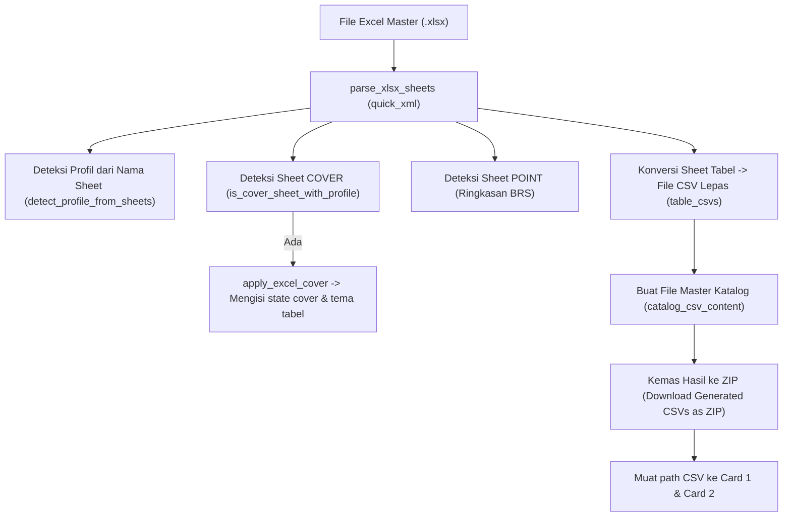

# Alur Pemrosesan Excel dan File Proyek di Modul PubGen Versi Sebelumnya

Dokumen ini mendokumentasikan hasil riset teknis mengenai cara modul PubGen versi sebelumnya di DesignCraft (`crates/ui-egui/src/panels/pubgen/`) menangani impor/ekspor Excel (`.xlsx`), generasi tabel/halaman otomatis, dan manajemen status proyek.

---

## 1. Arsitektur Proyek pada Modul PubGen Sebelumnya

Berbeda dengan aplikasi POS yang memiliki container terkompresi `.pubgen` mandiri, modul PubGen lama menggunakan pendekatan berbasis file terpisah (*loose files*) yang dicatat melalui konfigurasi engine dan `PubgenState`:

### 1.1 Penyimpanan Preferensi & State Proyek
- **Path Proyek**: Disimpan di preferensi engine via `app.session.prefs.pubgen_project_path` (biasanya mengarah ke file konfigurasi teks JSON seperti `pubgen_project.json`).
- **Kamus Istilah (Glossary)**: Disimpan secara terpisah di file eksternal yang ditunjuk oleh `app.session.prefs.pubgen_glossary_path` (default: kamus BPS lokal atau kustom).
- **Struktur State (`PubgenState`)**:
  - `PubgenState` (`crates/ui-egui/src/panels/pubgen/state.rs`) mengelola seluruh input form UI:
    - Card 1: Halaman dari CSV (`card1_path`, `card1_records`).
    - Card 2: Tabel dari CSV (`card2_path`, `card2_sheet_tables`).
    - Cover: Pengaturan sampul (`cover_title`, `cover_style`, `cover_palette`, AI prompts).
    - Header/Footer: Template running header (`hf_header_left`, `hf_header_right`).
    - Audit: Masalah audit preflight (`audit_issues`).

---

## 2. Alur Pemrosesan Excel (`.xlsx`) di Modul Sebelumnya

Modul lama mengimplementasikan parser XLSX manual langsung berbasis `quick_xml` dan `zip` di dalam `crates/ui-egui/src/panels/pubgen/excel.rs`, tanpa crate perantara tingkat tinggi seperti `calamine`.

### 2.1 Pembacaan Berkas XLSX Mentah (`parse_xlsx_sheets`)
1. Berkas `.xlsx` dibuka sebagai arsip ZIP.
2. Membaca tabel string bersama (`xl/sharedStrings.xml`) untuk memetakan indeks integer sel teks ke string aslinya.
3. Membaca lembar kerja individual (`xl/worksheets/sheet1.xml`, `sheet2.xml`...).
4. Mengurai tag XML `<row>`, `<c r="A1" t="s">`, `<v>`, serta tag penggabungan sel `<mergeCell ref="B2:C2"/>`.
5. Menghasilkan struktur `Vec<ExcelSheetData>`.

### 2.2 Konversi Excel ke CSV (`execute_excel_to_csvs`)

1. **Pembuatan File Katalog Master**:
   - Kolom: `type, number, title, file`.
   - Mengambil baris pertama dari masing-masing lembar kerja untuk menetapkan judul tabel dan nomor tabel.
2. **Pembuatan File CSV Tabel Individual**:
   - Setiap sheet tabel diubah menjadi file CSV di disk (di samping file Excel atau di folder output).
   - Penggabungan sel vertikal dan horizontal diterjemahkan ke notasi stacked header (`Header 1 -- Sub Header`).
3. **Penyimpanan Arsip ZIP CSV**:
   - Modul lama secara otomatis mengompresi kumpulan file CSV yang dihasilkan ke dalam arsip ZIP memory (`st.generated_zip_bytes`, `st.generated_zip_name`).
   - Tombol *"Download Generated CSVs as ZIP…"* disediakan di dialog agar pengguna dapat mengunduh paket CSV tersebut.

---

## 3. Alur Otomatisasi "Master Excel Import & Generate" (`execute_excel_and_generate`)

Modul lama memiliki tombol pop-up modal dialog *"Master Excel (.xlsx) Import & Generate"*:

1. **Pemilihan File**: Pengguna memilih file `.xlsx` melalui `app.ask_open`.
2. **Konversi Sheet**: `execute_excel_to_csvs` dijalankan.
3. **Generasi Dokumen Desain Langsung**:
   - Jika dokumen aktif belum ada di DesignCraft, membuat dokumen baru: `app.run("file.new", json!({"facingPages": true}))`.
   - **Cover Generation**:
     - BRS: `execute_generate_brs_front_and_point` membuat halaman sampul depan dan halaman poin indikator.
     - DDA: `execute_generate_front_cover` + `execute_generate_inside_cover`.
   - **Body Pages Generation**:
     - `execute_generate_pages` membaca katalog CSV, membuat frame teks, dan memanggil `execute_insert_table` untuk mengalirkan tabel setiap sheet ke halamannya masing-masing.
   - **Back Cover Generation**:
     - Membuat halaman belakang (`execute_generate_back_cover` / `execute_generate_brs_back_cover`).
   - **Header & Footer Generation**:
     - Memanggil `execute_apply_header_footer` untuk menyisipkan penomoran halaman dan running header.

---

## 4. Kelebihan dan Kekurangan Modul Versi Sebelumnya

### Kelebihan
- **Langsung Terintegrasi dengan Engine DesignCraft**: Perintah dieksekusi secara in-process melalui `app.run("cmd", json!({...}))` tanpa perlu subprocess CLI atau IPC.
- **Kustomisasi Detail**: Pengguna bisa mengatur opsi tabel per lembar di Card 2 (pilihan warna baris zebra, font judul tabel, border tebal, dsb.).

### Kekurangan
- **Tidak Memiliki Format Proyek Terpadu**: Proyek tidak bisa disimpan menjadi satu berkas mandiri. Jika folder dipindahkan, path CSV dan aset gambar di state menjadi *broken*.
- **UI Bertumpuk & Terlalu Banyak Dialog Modal**: Banyak dialog modal terpisah (Excel Dialog, Cover Dialog, TOC Dialog, Manual Dialog, Utils Dialog), membuat workflow terfragmentasi.
- **Parser XML Excel Manual**: Parser berbasis `quick_xml` manual rentan terhadap variasi tag XLSX yang kompleks dibandingkan crate matang seperti `calamine`.
- **Tidak Memiliki Mode Orchestrator Mandiri**: Hanya berupa panel sempit di dalam workspace DesignCraft utama.
