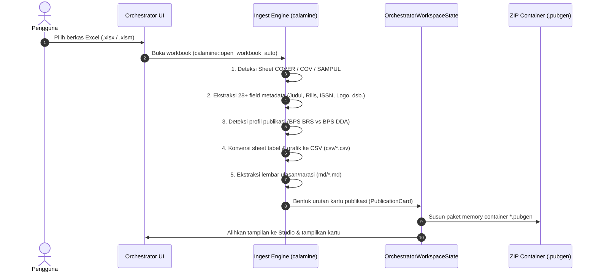
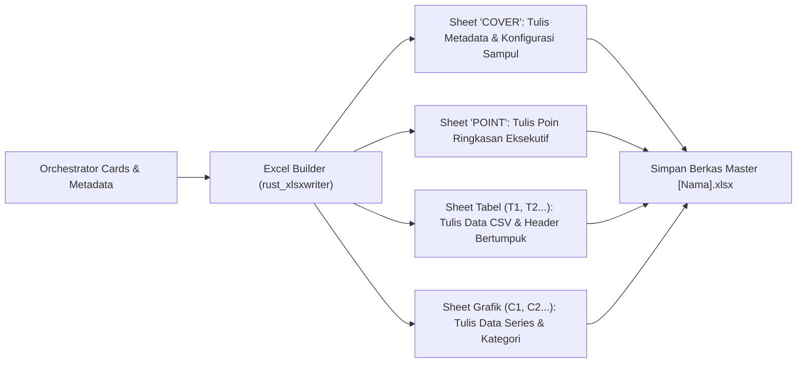

# Blueprint Arsitektur Pemrosesan Export Excel dan File *.pubgen di Mode Orchestrator

Dokumen ini merumuskan metode implementasi terpadu untuk pemrosesan import/export Excel (`.xlsx`) dan container berkas mandiri (`*.pubgen`) pada **Mode Orchestrator** DesignCraft PubGen, yang mensintesis keunggulan arsitektural dari aplikasi POS (`pos/`) dan modul PubGen lama (`crates/ui-egui/src/panels/pubgen/`).

---

## 1. Matriks Komparasi Arsitektur

| Aspek | Aplikasi POS (`pos/`) | Modul PubGen Lama (`crates/.../pubgen/`) | **Metode Baru (Mode Orchestrator)** |
| :--- | :--- | :--- | :--- |
| **Format Berkas Proyek** | Container ZIP mandiri `*.pubgen` | Berkas terpisah (*loose files* via JSON path) | **Container ZIP mandiri `*.pubgen` (100% kompatibel dengan POS)** |
| **Parser Berkas Excel** | `calamine` (sangat stabil & cepat) | `quick_xml` (penguraian XML manual) | **`calamine` (ekstraksi) + builder (ekspor)** |
| **Model Struktur Data** | `Project` + `Metadata` + `Vec<PageEntry>` | `PubgenState` (form-state datar) | **`OrchestratorWorkspaceState` + `Vec<PublicationCard>`** |
| **Eksekusi Engine** | Subprocess CLI (`designcraft-cli run`) via JSONL | In-Process Engine Command (`app.run`) | **In-Process Engine Command (`app.run`) + Zero Subprocess IPC** |
| **Ekspor ke Excel** | Belum tersedia (satu arah: Ingest saja) | Export ke CSV ZIP saja | **Ekspor Dua Arah (Round-trip: XLSX ⇄ PUBGEN)** |
| **Tampilan / UX** | Home Beranda + Canvas Terpisah | Dialog modal bertumpuk | **Home Beranda + 3-Panel Studio Terintegrasi** |

---

## 2. Struktur Data Proyek Mandiri `*.pubgen` di Mode Orchestrator

Format berkas proyek `.pubgen` pada Mode Orchestrator mempertahankan standar arsip ZIP yang kompatibel penuh dengan aplikasi POS, diperkaya dengan atribut spesifik DesignCraft:

```text
[NamaPublikasi].pubgen  (Format ZIP Mandiri)
├── pubgen.json               # Manifest proyek, metadata versi format, & slot frame
├── metadata.json             # Konfigurasi halaman, profil publikasi, & array kartu
├── glossary.json             # Kamus istilah dwibahasa BPS (ID ⇄ EN)
├── template.designcraft      # Dokumen template layout DesignCraft bawaan
├── csv/                      # Seluruh tabel data hasil ekstraksi (.csv)
│   ├── C1.csv                # Data grafik
│   ├── T1.csv                # Data tabel statistik
│   └── POINT.csv             # Poin-poin ringkasan
├── md/                       # Seluruh ulasan narasi bab (.md)
│   └── U1.md
└── assets/                   # Aset gambar, logo instansi, peta tematik GeoJSON
    ├── bps_logo.png
    ├── hero_cover.jpg
    └── jabar.geojson
```

### 2.1 Skema `pubgen.json` & `metadata.json`
`metadata.json` memetakan langsung struktur `PublicationCard` yang ada pada `OrchestratorWorkspaceState`:
- Setiap kartu menyimpan: `kind` (`Cover`, `Toc`, `Table`, `Chart`, `MapChart`, `Narrative`, `Divider`), `scope` (`NewPage` vs `NewObject`), `source` (path relatif internal `csv/...` atau `md/...`), penomoran halaman otomatis, dan parameter tampilan.

---

## 3. Alur Kerja Pemrosesan (Workflows)

### Alur 1: Impor Excel Master (`.xlsx`) ➔ Kartu Orchestrator

Ketika pengguna menekan tombol **"📊 Impor Manifest (XLSX)"** di Welcome Page atau di dalam Studio:



1. **Pembacaan Metadata**:
   - Lembar `COVER` diurai menjadi metadata utama: Judul ID, Judul EN, Nomor Rilis, Tanggal/Bulan Terbit, Instansi, Logo, dan Alamat Kantor.
2. **Klasifikasi Lembar Kerja Berdasarkan Aturan Profil**:
   - **Profil BRS**:
     - `COV`: Kartu Sampul (`Scope: NewPage`, template wave/origami).
     - `POINT`: Kartu Ringkasan Indikator (`Scope: NewPage`).
     - `U1`: Kartu Ulasan Bab Utama (`Scope: NewPage`).
     - `UX`, `CX`, `TX`, `GX`: Kartu Objek Mengalir (`Scope: NewObject`) yang dirangkai di dalam halaman bab tanpa membuat lonjakan halaman.
   - **Profil DDA**:
     - Setiap lembar tabel statistik dijadikan kartu halaman tersendiri (`Scope: NewPage`).
     - Pemisah bab (`DIV`) dibuat menjadi kartu Divider.
3. **Penyimpanan Lokal & Binding**:
   - Semua sheet disimpan ke folder kerja lokal `csv/` dan di-embed ke dalam state proyek sehingga tidak ada dependensi eksternal yang hilang.

---

### Alur 2: Penyimpanan & Pembukaan Berkas Proyek `*.pubgen`

#### A. Menyimpan Proyek (`Project::save`)
1. Pengguna mengklik tombol `💾 Simpan` atau memilih menu *File ▸ Simpan Workspace Publikasi*.
2. Seluruh state `OrchestratorWorkspaceState` (kartu publikasi, form pengaturan rilis, slots, log eksekusi) diserialisasikan ke format JSON.
3. Berkas ditulis ke arsip ZIP temporer (`.tmp`), lalu di-rename secara atomik ke `[Nama].pubgen`.
4. State ditandai bersih (`is_dirty = false`).

#### B. Membuka Proyek (`Project::open`)
1. Pengguna memilih berkas `*.pubgen`.
2. Arsip ZIP dibuka: `metadata.json`, `pubgen.json`, dan `glossary.json` dimuat kembali ke struct state.
3. Seluruh berkas `csv/` dan `md/` diekstrak ke folder kerja lokal di samping file `.pubgen`.
4. Workspace Studio langsung menampilkan kartu-kartu publikasi dengan thumbnail dan parameter yang persis sama seperti saat terakhir disimpan.

---

### Alur 3: Ekspor Workspace Orchestrator ➔ Berkas Excel Master (`.xlsx`)

Fitur ini memberikan kemampuan dua arah (*round-trip*): pengguna atau editor data dapat mengekspor struktur publikasi yang telah dirancang di Orchestrator kembali ke dalam berkas Excel terstandarisasi.



1. **Sheet `COVER`**:
   - Menghasilkan lembar 2-kolom (Key-Value) standar BPS:
     - `title`: Judul Publikasi.
     - `title_en`: Judul Bahasa Inggris.
     - `release_no`, `release_date`, `release_month`.
     - `agency`, `office_address`, `logo`, `table_theme`.
2. **Sheet `POINT`**:
   - Menuliskan baris-baris butir ringkasan eksekutif.
3. **Sheet Data Tabel & Grafik**:
   - Setiap kartu tabel (`CardKind::Table`) dan bagan (`CardKind::Chart`) diekspor menjadi worksheet Excel individual dengan judul sheet yang rapi (`T1`, `T2`, `C1`...).
   - Format angka (ribuan dengan tanda titik/koma) dipertahankan sesuai konfigurasi bahasa dokumen.

---

### Alur 4: Kompilasi Dokumen Desain & Publikasi PDF

Ketika pengguna menekan tombol **"🚀 Kompilasi Dokumen"** atau **"Publish PDF"**:
1. **Safety Preflight Guard**:
   - Menjalankan audit validasi cepat (`preflight.pubgen`) untuk memeriksa apakah ada kartu tabel tanpa sumber data CSV atau aset gambar yang hilang.
2. **Eksekusi In-Process Engine DesignCraft**:
   - Tidak memerlukan pemanggilan proses eksternal (CLI).
   - Memanggil perintah engine langsung:
     - `file.new`: Membuat dokumen baru dengan ukuran A4 dan margin sesuai profil.
     - `pubgen.generateCover`: Menyisipkan halaman sampul depan dari template SVG/DesignCraft di `assets/templates/covers/`.
     - `toc.generate`: Membangun halaman Daftar Isi dinamis.
     - `table.create` & `autoflow`: Mengalirkan tabel data dari file CSV dengan penataan baris zebra dan garis batas sesuai tema.
     - `header_footer.apply`: Menempatkan running header dan nomor halaman ganjil/genap.
3. **Export Hasil Akhir**:
   - Mengekspor layout ke berkas PDF siap cetak / digital: `outputs/[Nama_Publikasi].pdf`.

---

## 4. Modul Kode yang Diperlukan pada Crates

Untuk mewujudkan arsitektur ini secara bersih tanpa melanggar batasan layering (`cargo xtask layers`):

1. **`crates/pubgen-core/src/project.rs`** (atau modul terkait):
   - Definisi struct `ProjectContainer`, `ProjectManifest`, fungsi `open_pubgen`, dan `save_pubgen`.
   - Menggunakan crate `zip` untuk kompresi dan dekompresi atomik.
2. **`crates/pubgen-core/src/excel/ingest.rs`**:
   - Implementasi parser pembaca Excel menggunakan `calamine`.
   - Fungsi `parse_excel_cover`, `detect_workbook_profile`, `extract_content_cards`, dan `sheet_to_csv`.
3. **`crates/pubgen-core/src/excel/export.rs`**:
   - Fungsi generator `export_cards_to_xlsx(metadata, cards, output_path)` yang menyusun file workbook Excel terstandarisasi.
4. **`crates/ui-egui/src/panels/pubgen/workspace.rs`**:
   - Mengintegrasikan fungsi import/export di atas langsung ke tombol UI Orchestrator:
     - Tombol *Buka Berkas (.pubgen)* ➔ `open_pubgen`.
     - Tombol *Impor Manifest (XLSX)* ➔ `ingest_excel`.
     - Tombol *Simpan Workspace* ➔ `save_pubgen`.
     - Tombol *Ekspor ke Excel (.xlsx)* ➔ `export_cards_to_xlsx`.
