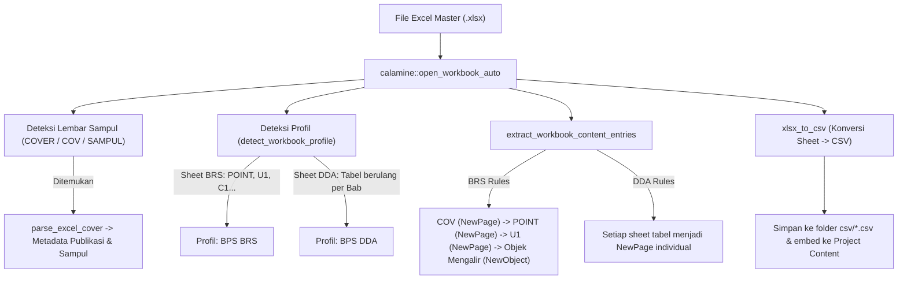

# Alur Pemrosesan Export Excel dan File *.pubgen di Aplikasi POS

Dokumen ini memuat hasil riset teknis mendalam mengenai arsitektur, struktur data, dan alur pemrosesan import/export Excel (`.xlsx`) serta container proyek mandiri (`*.pubgen`) pada aplikasi **Publication Orchestrator Studio (POS)** (`pos/`).

---

## 1. Arsitektur Container Berkas `*.pubgen`

Di dalam POS (`pos/app/src/project.rs`), berkas `*.pubgen` bukan sekadar file JSON mentah atau teks konfigurasi biasa, melainkan sebuah **arsip ZIP terkompresi (Deflated)** yang bersifat *self-contained* (mandiri dan portabel).

### Struktur Internal Berkas `*.pubgen` (ZIP)

```text
[NamaDokumen].pubgen  (ZIP Container)
├── pubgen.json               # Manifest identitas proyek & slot token
├── metadata.json             # Metadata publikasi BPS & daftar kartu halaman (PageEntry)
├── glossary.json             # Kamus istilah dwibahasa (ID-EN) untuk AI/terjemahan
├── template.designcraft      # (Opsional) Dokumen template biner DesignCraft
├── csv/                      # Seluruh tabel data hasil konversi dari lembar Excel
│   ├── C1.csv
│   ├── T1.csv
│   └── POINT.csv
├── md/                       # Seluruh ulasan narasi bab hasil konversi DOCX/RTF
│   ├── U1.md
│   └── U2.md
└── [extras]                  # Aset gambar, QR code, logo, dsb. (assets/*.png)
```

### 1.1 Spesifikasi Isi Setiap Komponen Container

1. **`pubgen.json` (Project Manifest)**:
   ```rust
   #[derive(Serialize, Deserialize)]
   struct Manifest {
       format_version: u64, // Format versi 1
       name: String,        // Nama publikasi / proyek
       template: bool,      // Apakah menyertakan template.designcraft bawaan
       slots: Vec<Slot>,    // Daftar slot frame dinamis (budget kata, teks pengganti)
   }
   ```
2. **`metadata.json` (Publication Metadata & Page Tree)**:
   Menyimpan seluruh konfigurasi tata letak publikasi statistik:
   - `profile_id`: Identifikasi profil (misal `"bps_brs"` atau `"bps_dda"`).
   - `layout`: `PageLayout::Single` atau `PageLayout::Double` (Facing Spreads).
   - `lang`: Bahasa publikasi (`Lang::Id`, `Lang::En`, atau `Lang::IdEn`).
   - `pages`: Vektor `PageEntry` (kartu publikasi: Cover, TOC, Infografis/Chart, Tabel, Ulasan Narasi, Pemisah Bab).
3. **`glossary.json`**:
   Menyimpan kamus istilah resmi BPS (`Vec<Entry>`) yang mencegah penerjemahan istilah baku (misal *"Nilai Tukar Petani"* tidak boleh diterjemahkan harfiah jika ada aturan khususnya).
4. **`csv/` & `md/` Content Files**:
   Setiap berkas teks data tabel CSV dan bab narasi Markdown diekstrak dan disimpan dalam container sehingga saat file `.pubgen` dipindahkan ke komputer lain, tidak ada *broken link* atau dependensi path absolut.

### 1.2 Alur Penyimpanan Atomik (`Project::save`)
Untuk mencegah korupsi file jika proses terputus:
1. POS menulis ke file temporer: `path.with_extension("pubgen.tmp")`.
2. Menggunakan `zip::ZipWriter` dengan kompresi `CompressionMethod::Deflated`.
3. Menulis `pubgen.json`, `metadata.json`, `glossary.json`, seluruh `content` (`csv/`, `md/`), dan `template.designcraft`.
4. Setelah `zip.finish()` berhasil, file temporer di-rename secara atomik menggantikan file target (`std::fs::rename`).

### 1.3 Alur Pembukaan Proyek (`Project::open`)
1. Membaca arsip ZIP via `zip::ZipArchive`.
2. Membaca dan memvalidasi `pubgen.json` (`format_version <= FORMAT_VERSION`).
3. Membaca `metadata.json` menjadi struct `Metadata`.
4. Mengekstrak file `md/` dan `csv/` ke folder kerja lokal di samping file `.pubgen` (`materialize`), sehingga engine DesignCraft dapat membaca file sumber secara langsung.

---

## 2. Alur Pemrosesan Berkas Excel (`.xlsx`) di POS

Pemrosesan berkas Excel di POS berpusat pada modul `pos/app/src/ingest.rs` menggunakan crate pembaca Excel berkinerja tinggi **`calamine`**.

### Diagram Alur Ingest Excel



### 2.1 Deteksi dan Ekstraksi Metadata Lembar `COVER` (`parse_excel_cover`)
POS memindai apakah ada worksheet bernama `COVER`, `COV`, atau `SAMPUL`. Lembar ini berisi pasangan kunci-nilai (key-value baris 2D):
- `title` / `title1`: Judul Publikasi Bahasa Indonesia.
- `title2` / `title_en`: Judul Bahasa Inggris atau Subjudul Wilayah.
- `year` / `tahun`, `volume` / `vol`, `catalogue`, `issn` / `isbn`.
- `agency` / `instansi`: Lembaga penerbit (misal: "BADAN PUSAT STATISTIK").
- `image1` / `theme1`: File path foto sampul utama.
- `logo`: File path logo instansi (`bps_logo.png`).
- `table_theme` / `palette`: Palet warna tabel (misal: Navy, Teal, Amber).
- `point` / `ringkasan`: Teks ringkasan eksekutif poin utama.

### 2.2 Aturan Sheet BRS vs DDA (`extract_workbook_content_entries`)
1. **Aturan BPS BRS (Berita Resmi Statistik)**:
   - Lembar `COV`: Dibuat menjadi kartu **Sampul Depan (Cover)** (`Scope: NewPage`).
   - Lembar `POINT` / `RINGKASAN`: Dibuat menjadi kartu **Poin Ringkasan Eksekutif** (`Scope: NewPage`), dikonversi menjadi CSV 1-kolom dengan header `item`.
   - Lembar `U1`: Dibuat menjadi kartu **Ulasan Indikator Utama** (`Scope: NewPage`).
   - Lembar `UX` lainnya (`U2`, `U3`...), `CX` (grafik), `TX` (tabel), `GX` (gambar/peta): Dibuat sebagai **Objek Mengalir** (`Scope: NewObject`) yang disisipkan berurutan di dalam halaman bab tanpa membuat halaman baru secara paksa.
2. **Aturan BPS DDA (Daerah Dalam Angka)**:
   - Setiap tabel data merupakan lembar tersendiri dengan penomoran bab (misal `1.1.1`, `1.1.2`). Setiap sheet diekstrak menjadi satu kartu dengan `Scope: NewPage`.

### 2.3 Konversi Lembar Kerja Menjadi CSV (`xlsx_to_csv`)
- Mengonversi grid 2D cell Excel menjadi teks CSV standar RFC 4180.
- Deteksi tipe bagan (`sheet_chart_type`):
  - Memeriksa sel metadata lembar untuk mengetahui apakah lembar tersebut adalah `LineChart`, `BarChart`, `PieChart`, atau `MapChart`.
- Menangani header bertumpuk (*stacked headers*): baris gabungan dikonversi menggunakan notasi pemisah `--`.
- Menuliskan hasil konversi ke folder `csv/[nama_sheet].csv` serta memasukkannya ke dalam memori `Project.content`.

---

## 3. Ekspor dan Generasi Dokumen di POS

Pada POS (`pos/app/src/actions.rs`), ekspor Excel dan generasi layout bekerja dengan alur:
1. **Auto-Save Project (`ensure_project_saved`)**:
   - Jika proyek diimpor dari `Laporan.xlsx`, POS otomatis menyimpan workspace menjadi `Laporan.pubgen` di direktori yang sama sebelum generasi dimulai.
2. **Materialisasi Aset & Konten**:
   - Konten `csv/` dan `md/` diekstrak ke `%TEMP%/pubgen/` atau folder kerja lokal.
3. **Kompilasi & Publikasi PDF (`batch_generate`)**:
   - Membangun interpreter command script (`fill.jsonl`).
   - Memanggil CLI backend dengan argumen `--save [nama].designcraft` dan `--export [nama].pdf`.
   - Menjalankan audit preflight (`run_pubgen_audit`) untuk memastikan tidak ada teks terpotong (*overset text*) atau tabel overflow.
