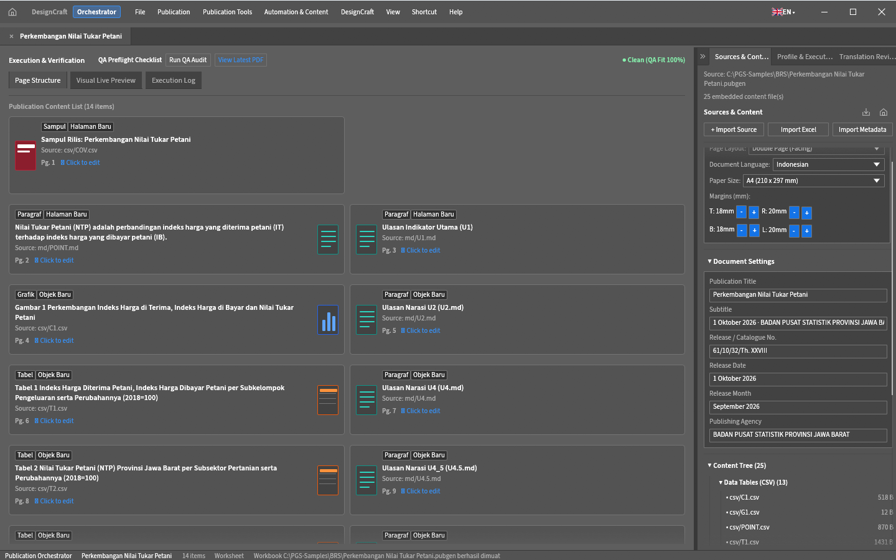
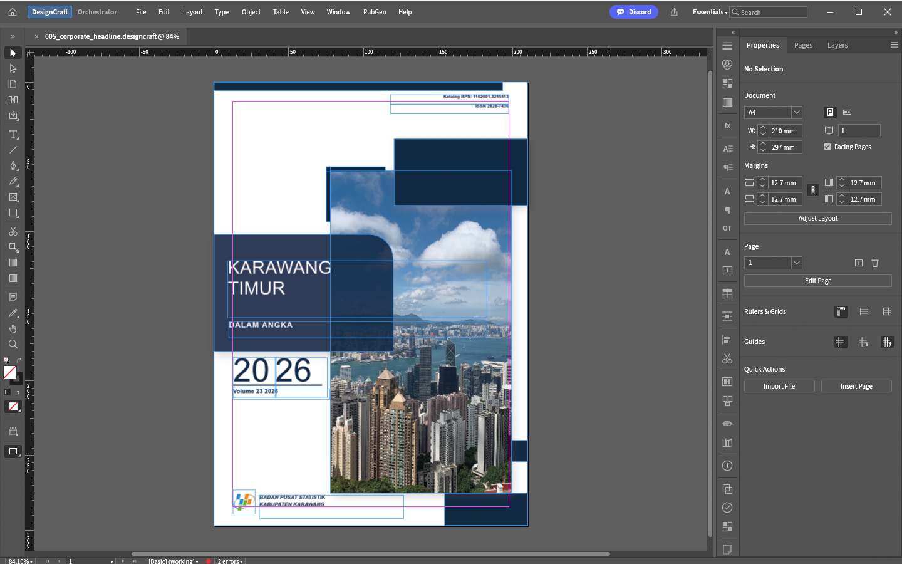

## 1. Apa itu PubGen Studio (PGS)?

**PubGen Studio (PGS)** adalah aplikasi generator publikasi untuk Windows x64 yang berjalan di atas mesin tata letak DesignCraft. Satu jendela, dua mode: **Orchestrator** untuk menyusun publikasi dari sumber data, dan **DesignCraft** untuk merapikan halaman secara manual.

Rilis terbaru adalah **v0.19.0-pgs.0.9.1**, dipaketkan sebagai aplikasi portabel Windows x64 dengan berkas program **`pgs.exe`**. Di folder yang sama terdapat `pgs-cli.exe` (kompilasi dan terjemahan tanpa antarmuka), `pgs-export.exe` (paket `.pubgen`/XLSX menjadi manifest), dan `designcraft-cli.exe` (penjalan skrip mesin DesignCraft). Preferensi, log, dan pemulihan disimpan di folder `DesignCraftData/` persis di samping `pgs.exe`; tidak ada installer dan tidak ada tulisan ke `%APPDATA%`.

Dalam aplikasi tata letak konvensional (seperti Adobe InDesign atau QuarkXPress), pembuatan publikasi statistik setebal ratusan halaman (seperti buku *Kecamatan Dalam Angka*, *Kabupaten Dalam Angka*, atau Laporan Tahunan) menuntut ratusan langkah manual yang memakan waktu: menggambar kotak teks satu per satu, mengatur gaya judul, merapikan batas tabel, memasukkan logo, dan menyusun titik-titik daftar isi.

PGS mengotomatiskan seluruh alur kerja tersebut:

- **Sampul Instan**: Membangun sampul korporat eksekutif lengkap dengan geometri modern, bayangan lembut, foto terpotong rapi, dan tipografi resmi — depan, dalam, dan belakang.
- **Halaman Otomatis**: Membaca daftar bab atau tabel dari Excel/CSV dan menyusun puluhan halaman rapi dalam hitungan detik.
- **Tabel Standar Penerbitan**: Memformat tabel data mengikuti standar baku BPS (garis horizontal tipis-tebal *booktabs*, header bertingkat, penomoran kolom resmi, serta penyorotan baris Jumlah/Total secara otomatis).
- **Grafik Vektor**: Mengubah sheet `CXX_XX` (atau tabel yang sudah ada) menjadi grafik asli yang bisa diedit — sembilan arketipe, dari batang dan garis sampai piramida penduduk, gauge, dan peta GeoJSON.
- **Generate & Publish**: Satu daftar kartu halaman menghasilkan seluruh publikasi; **Generate Publication** mengompilasi halaman, **Generate & Publish PDF** sekaligus mengekspor PDF rilis.
- **Workspace Kartu**: Sumber diimpor menjadi kartu halaman (Sampul, Paragraf, Grafik, Peta, Tabel, Gambar, Daftar Isi, Pembatas) yang bisa diperiksa dan diubah per kartu.
- **Satu Berkas Proyek**: Seluruh publikasi tersimpan dalam paket **`.pubgen`** — metadata, sumber, aset, glosarium, memori terjemahan, dan tata letak hasil kompilasi.
- **Audit Mutu**: Preflight statistik memeriksa sel tabel terpotong, sumber yang hilang, nomor tabel yang loncat, kesetaraan dwibahasa, DPI gambar, dan — untuk cetak — spine serta bleed, dengan baris yang bisa diklik.
- **Profil & Terminologi**: Profil publikasi mengganti perutean sheet, penamaan, geometri, dan gaya tabel; glosarium yang bisa diedit menjaga terjemahan AI memakai istilah statistik resmi.
- **Alat Editorial Praktis**: Memudahkan pengelolaan halaman bolak-balik (ganda), penomoran angka Romawi dan Arab, header dan footer, pengaliran teks dokumen RTF, serta peremajaan Daftar Isi secara dinamis.

---

## 2. Mengenal PubGen Studio: dua mode dan bilah menunya

Saat PGS dibuka tanpa berkas, aplikasi masuk ke **mode Orchestrator** — beranda tempat publikasi dimulai. Di kiri bilah atas, setelah ikon Home, ada dua **pil mode**: `DesignCraft | Orchestrator`. Pil yang aktif ditandai seleksi terisi dan bingkai aksen; arahkan kursor ke pil untuk melihat keterangannya (*DesignCraft Layout Studio* / *Publication Orchestrator*). Memilih **Orchestrator** juga mengaktifkan panel PubGen.

Aturan peluncuran aplikasi:

- tanpa argumen → mode **Orchestrator** (beranda);
- berkas `*.pubgen` → mode **Orchestrator**, paket dibuka di tab workspace;
- berkas `*.designcraft` → mode **DesignCraft** dengan dokumen tersebut;
- jalur berkas lain → mode **Orchestrator**.

Klik dua kali sebuah `.pubgen` di Explorer juga membukanya di PGS (asosiasi berkas per pengguna didaftarkan saat aplikasi mulai).

Mode yang aktif menentukan bilah menu. Bar bawaan **Orchestrator** berisi delapan menu:

```
+---------------------------------------------------------------------------------------------------------------+
| ⌂  DesignCraft | Orchestrator   File  Publication  Publication Tools  Automation & Content  DesignCraft  View  Shortcut  Help |
+---------------------------------------------------------------------------------------------------------------+
```

Sedangkan mode **DesignCraft** mengembalikan bilah bawaan mesin tata letak, dengan satu menu **PubGen** tepat sebelum **Help**:

```
+-----------------------------------------------------------------------------------------------------------+
| ⌂  DesignCraft | Orchestrator   File  Edit  Layout  Type  Object  Table  View  Window  PubGen  Help |
+-----------------------------------------------------------------------------------------------------------+
```

| Menu (mode Orchestrator) | Isinya |
|---|---|
| **File** | Proyek publikasi: **New Publication** (`Ctrl+N`), **Open Publication (.pubgen)…**, **Save Publication (.pubgen)** (`Ctrl+Shift+S`), **Save Publication As (.pubgen)…**; **Import Excel Workbook (.xlsx)…** dan **Export Excel Workbook (.xlsx)…**; **Template ▸ Open…**; **Output ▸ Export PDF…**. |
| **Publication** | Alur publikasi: **Import Manifest (XLSX)** (`Ctrl+Shift+G`, dulu “Generate from Excel”), **Compile Publication** (`Ctrl+Shift+B`), **Publication Profile**, **Vector Chart** (`Ctrl+Shift+V`), **Table of Contents** (`Ctrl+Alt+T`), **Publication Cover**, **Header & Footer Setup**, **Audit Publication** (`Ctrl+Shift+Alt+A`), lalu submenu **Publication Profiles** (profil aktif bertanda ✓, **Customize Active Profile…**, **Apply Profile Margins**). |
| **Publication Tools** | **Manual Ingest & Tables** (Page from CSV…, Table from CSV…), **Publication Profiles**, **Page & Layout Utilities** (Publication Profile, Apply Profile Margins, Standard BPS Margins `Ctrl+Shift+M`, Page Margins & Renumbering Options…), centang **Dual Language Mode** (`Ctrl+Shift+L`), dan **AI Translate** (Translate Selected Page, Translate Review Pages, Translate Table Pages…, Setup…). |
| **Automation & Content** | **Automation** (Publication Cover, Vector Chart, Table of Contents), **AI Translation & Terminology**, dan **Batch Generation** (Import Manifest (XLSX)). |
| **DesignCraft** | **Switch to DesignCraft Studio**, **Layout Documents** (Open…, Save, Save As…), dan **DesignCraft Settings** (Keyboard Shortcuts…, Preferences…). |
| **View** | Baris mode yang bisa dicentang (**Publication Orchestrator** / **DesignCraft Layout Studio**), **Panels ▸ PubGen Panel**, **Language / Bahasa** (Bahasa Indonesia / English), dan **Theme / Tema**. |
| **Shortcut** | Akses cepat: **Export PDF…**, **Save Publication (.pubgen)**, **Open Publication (.pubgen)…**, **Preflight Document**, **Package…**. |
| **Help** | Baris Help bawaan DesignCraft, lalu **About PubGen…** dan pengalih bilah menu **Show DesignCraft Menus / Show PubGen Menus**. |

Alur terpendek di mode Orchestrator: **Open file (.pubgen)** atau **Import Manifest (XLSX)** di beranda → pilih profil di kartu beranda → periksa kartu di tab **Page Structure** → tekan **Generate & Publish PDF** di dock **Profile & Execution**.

Jalur menu **Publication** tetap lengkap untuk kerja per bagian: **Compile Publication** (§10), **Vector Chart** (§8), **Header & Footer Setup** (§9), **Publication Profile** (§12), dan **Audit Publication** (§11). Tindakan editorial (sebaran satu sisi, halaman kosong, halaman RTF dan gambar, penomoran ulang halaman) ada di **Publication Tools ▸ Page & Layout Utilities**, sedangkan jalur manual dari **Publication Tools ▸ Manual Ingest & Tables**.

### Beranda Orchestrator

Beranda muncul saat aplikasi dibuka tanpa proyek dan saat tombol **Home** di workspace ditekan.

```
┌ PubGen Studio ─────────────────────────────────────────────────────────────┐
│ ⌂  DesignCraft | Orchestrator   File  Publication  …                       │
├────────────────────────────────────────────────────────────────────────────┤
│  [PGS icon]  Welcome to Publication Orchestrator                           │
│              Page layout for print and screen — fast, open and scriptable. │
│                                                                            │
│  [Open file (.pubgen)] [Import Manifest (XLSX)] [Sample BRS] [Sample DDA]  │
│  [Open Active Studio]   ← hanya bila sesi sudah memiliki kartu             │
│                                                                            │
│  Publication Profiles                                                      │
│  ┌ DDA BPS ──────────┐ ┌ BRS BPS ──────────┐ ┌ General ──────────┐         │
│  │ Daerah Dalam Angka│ │ Berita Resmi Stat.│ │ Generic Publ. Rep.│         │
│  │ A4 · Facing Pages │ │ A4 · Single Page  │ │ A4 · Single Page  │         │
│  └───────────────────┘ └───────────────────┘ └───────────────────┘         │
│                                                                            │
│  Recent Opened Documents (*.pubgen)                                        │
└────────────────────────────────────────────────────────────────────────────┘
```

- **Aksi**: **Open file (.pubgen)**, **Import Manifest (XLSX)**, **Sample BRS**, **Sample DDA**, dan **Open Active Studio** (hanya tampil bila sesi sudah memiliki kartu).
- **Publication Profiles**: tiga kartu profil — **DDA BPS** (*Daerah Dalam Angka*, A4, halaman berhadapan), **BRS BPS** (*Berita Resmi Statistik*, A4, satu halaman), dan **General** (*Generic Publication Report*, A4, satu halaman). Mengklik kartu memilih profil, menyetel tata letak, dan langsung membuka Studio.
- **Recent Opened Documents (\*.pubgen)**: daftar paket terakhir; bila kosong, tertulis “No recent .pubgen files yet. Open a project file or import an XLSX to begin.” Baris yang diklik membuka `.pubgen` di tab, mengimpor `.xlsx`/`.xlsm`, atau membuka Studio.
- Bilah status di bawah menampilkan mode, nama publikasi, jumlah item, dan tampilan aktif — misalnya `Publication Orchestrator · JUDUL · 14 items · Home`.

### Studio Orchestrator: tiga panel

Setelah proyek dibuka, jendela menampilkan tab strip dokumen, kolom tengah **Execution & Verification**, dan **dock kanan** yang bisa dilipat.



*Studio Orchestrator dengan paket contoh: kartu halaman di tab **Page Structure**, strip **QA Preflight Checklist**, dan dock kanan pada tab **Sources & Content**.*

**Kolom tengah — Execution & Verification**

- Header memuat **QA Preflight Checklist**, tombol **Run QA Audit**, tombol **View Latest PDF** (muncul setelah ada keluaran), dan chip status **● Clean (QA Fit 100%)** (hijau) atau **● Issues Detected** (merah).
- Tiga tab: **Page Structure** | **Visual Live Preview** | **Execution Log**.
- **Page Structure** menampilkan **Publication Content List (N items)** berupa grid kartu. Ada delapan jenis kartu: **Sampul**, **Paragraf**, **Grafik**, **Peta**, **Tabel**, **Gambar**, **Daftar Isi**, dan **Pembatas**. Setiap kartu menunjukkan chip lingkup **Halaman Baru** atau **Objek Baru**, judul, sumber (`Source: csv/…`, `md/…`), dan tautan **Click to edit** yang membuka modal edit kartu dengan tab **Konten/Sumber**, **Tata Letak/Seksi**, serta **Header & Footer**.
- **Execution Log** menampilkan baris log bertimestamp — profil aktif, geometri halaman, jumlah berkas sumber yang dimuat, struktur kartu, dan hasil audit.
- Tombol **Run QA Audit** hanya menjalankan pemeriksaan ringkas pada alur kartu dan menandai status QA; audit lengkap tetap lewat **Publication ▸ Audit Publication** (§11).

**Dock kanan**

Tiga tab: **Sources & Content**, **Profile & Execution**, dan **Translation Review**. Panel bisa dilipat menjadi ikon dan lebarnya diatur lewat pembatas yang bisa digeser.

- **Sources & Content** — baris `Source: <jalur>`, jumlah berkas tertanam, tombol **Home** dan **Save**; baris impor **+ Import Source**, **Import Excel**, **Import Metadata**; kotak **General Settings** (misalnya *BRS BPS Profile*) berisi **Page Layout** (Double Page (Facing) / Single Page (Non-Facing)), **Document Language** (Indonesian / English / Indonesian-English), **Paper Size** (A4 / Letter / B5), dan **Margins (mm)** T/R/B/L; bagian **Document Settings** (Publication Title, Subtitle, Release / Catalogue No., Release Date, Release Month, Publishing Agency); serta **Content Tree** berisi grup **Data Tables (CSV)** dan **Narrative (RTF)** beserta jalur dan ukuran berkas.
- **Profile & Execution** — combo **Publication Profile**, tombol **Translate with AI** beserta progresnya, tombol **Generate Publication** dan **Generate & Publish PDF**, blok **Layout Engine** (*● Integrated (DesignCraft Native OK)*), serta **Detected Slots** berisi kartu slot dengan chip `● OK` / `● Over` untuk anggaran karakter.
- **Translation Review** — daftar draf terjemahan AI yang belum diulas, dengan tombol **Accept** dan **Reject**; keputusan disimpan di memori terjemahan paket (§13).

**Generate dan pengamannya**

- **Generate Publication** dan **Generate & Publish PDF** berada di dock **Profile & Execution**. Bila dokumen aktif belum punya halaman, kompilasi langsung berjalan dengan modal progres; bila sudah punya halaman dan suntingan manual, muncul **Compilation Safety Guard** lebih dulu.
- **Compilation Safety Guard** menjelaskan bahwa rekompilasi membangun ulang setiap halaman dari data worksheet dan dapat menimpa penyesuaian tipografi, posisi bingkai, atau gaya manual dari mode DesignCraft. Pilihannya: **Save as New Version (v2)** (menyimpan tata letak saat ini sebagai `outputs/JUDUL_v2.designcraft` lalu mengompilasi), **Overwrite Layout** (memulai dokumen baru lalu mengompilasi), atau **Cancel**.
- Modal progres kompilasi menyebut setiap langkah — dokumen, halaman induk, sampul, bagian depan, placeholder daftar isi, tiap bab, sampul belakang, daftar isi, penomoran halaman, running header, simpan, dan PDF — dengan tombol **Cancel**.
- Menutup tab publikasi yang belum disimpan memunculkan konfirmasi **Close publication workspace?** dengan pilihan **Close without saving** / **Cancel**.

**Paket `.pubgen`**

Proyek 0.9 adalah paket portabel: berkas ZIP berisi `pubgen.json`, `metadata.json`, `glossary.json`, folder `csv/`, `md/` (atau `rtf/`), `assets/`, dan opsional `template.designcraft`. Tata letak hasil kompilasi dapat disimpan di samping paket. Gunakan **File ▸ Save Publication (.pubgen)** untuk menyimpan workspace ke paketnya, **Open Publication (.pubgen)…** untuk membuka, serta **Import/Export Excel Workbook (.xlsx)** untuk bolak-balik data dengan Excel. Manifest `pubgen_project.json` tetap dipakai sebagai kontrak compiler/CLI (§10), bukan sebagai berkas proyek sehari-hari.

### Mode DesignCraft

Memilih pil **DesignCraft** (atau membuka berkas `.designcraft`) menampilkan kanvas tata letak penuh: bilah menu bawaan, panel **Properties** dan **Pages**, penggaris, thumbnail halaman, kotak dokumen, **Adjust Layout**, **Quick Actions** (Import File, Insert Page), serta zoom dokumen.



*Mode **DesignCraft** — bilah bawaan `File Edit Layout Type Object Table View Window PubGen Help`, panel Properties/Pages, dan kanvas halaman. Menu **PubGen** di sini membawa seluruh aksi generator.*

Semua yang dihasilkan generator adalah dokumen DesignCraft biasa yang bisa diedit. Dokumen yang disimpan di samping sebuah `.pubgen` menjadi tata letak sidecar paket itu (`NAMA.designcraft`).

### Beralih mode

- Cara utama: pil **DesignCraft | Orchestrator** di kiri bilah atas, atau baris mode di menu **View** (**Publication Orchestrator** / **DesignCraft Layout Studio**).
- **Help ▸ Show DesignCraft Menus / Show PubGen Menus** masih ada, tetapi hanya menukar bilah menu dalam mode Orchestrator — bukan pengalih mode. Aplikasi yang baru dibuka selalu mulai di mode **Orchestrator**.

### Panel PubGen (mode DesignCraft)

Panel klasik masih tersedia untuk kerja manual dan dibuka dari **View ▸ Panels ▸ PubGen Panel**. Di mode Orchestrator, permukaan kerja utamanya adalah **Studio** (tiga panel di atas); panel ini hanya relevan saat Anda bekerja di kanvas DesignCraft.

| Area | Fungsinya |
|---|---|
| **Header panel** | Pemilih profil dengan ringkasan satu baris, **AI Translator**, **Translate this Page** (atau *Translate Review / Translate Table on this Page*), **Fix Terms**, **Retranslate (Glossary)**, **Translate Tables…**, **Audit Publication**, **Set Page Margin**, dan lencana Single/Dual Lang. |
| **Publication Compiler** | Satu manifest menjadi seluruh publikasi (§10), khusus desktop. |
| **1. Data Source & Generate (Master Excel)** | Alur buku kerja satu tombol (§7). |
| **2. Table of Contents** | Gaya, judul, tata letak ToC, dan **Add TOC / Rebuild TOC** (§6). |
| **3. Manual Import & Fine-Tuning** | Grup yang bisa dilipat berisi **Page from CSV** (§4) dan **Table from CSV** (§5) untuk kerja manual. |
| **4. Page Utilities** | Sakelar sebaran, halaman kosong, penomoran ulang halaman dan seksi (§6). |

Dialog yang terbuka di atasnya: Master Excel, Publication Cover, Table of Contents, Header & Footer, Vector Chart, Audit Publication, kustomisasi profil, penyiapan AI, **Compilation Safety Guard**, modal edit kartu, **Translate with AI — setup**, **AI Base Cover Setup**, dan About PubGen.

### Tombol Mode Dwi Bahasa (`Single Lang` / `Dual Lang`)

Baris **Dual Language Mode** pada menu **Publication Tools** (`Ctrl+Shift+L`) mencentang atau melepas keluaran dwi bahasa. Di 0.9 baris ini **aktif secara bawaan**; memilih profil **BPS Berita Resmi Statistik (BRS)** mematikannya, dan Anda bisa mencentang ulang untuk keluaran Indonesia–Inggris.

- **Single Lang**: Pembuatan publikasi satu bahasa (monolingual) standar seperti sebelumnya.
- **Dual Lang**: Menghasilkan publikasi dwi bahasa Indonesia-Inggris sesuai standar publikasi BPS:
  - **Sampul Depan**: Menautkan judul bahasa Inggris ke bingkai `#slot:text:title_en` bila templat menyediakannya, dan bila tidak ke baris judul kedua (`title#2`).
  - **Halaman Pembatas Bab (`DIV`)**: Menampilkan judul ganda dengan subjudul bahasa Inggris menggunakan warna aksen.
  - **Bab Ulasan (`RXX`) & Bagian Depan (`BXX`)**: Membuat sebaran berurutan (halaman Indonesia diikuti halaman Inggris).
  - **Tabel Statistik (`XX_XX`)**: Menggunakan tajuk 2 baris (`Tabel` / `Table` miring) dan judul 2 baris dengan teks Inggris dicetak miring.
  - **Grafik (`CXX_XX`)**: Memformat judul dwi bahasa (baris Indonesia, lalu `Figure NN.NN …` miring) dengan tipografi Inggris yang benar.

### AI dalam satu paragraf

AI bersifat opsional dan diatur lewat **Publication Tools ▸ AI Translate ▸ Setup…** (dialog **Translate with AI — setup**). Penyedia yang didukung: **Groq**, endpoint kustom yang kompatibel OpenAI, dan server lokal (Ollama, LM Studio). Terjemahan disimpan di memori terjemahan paket `.pubgen` dan bisa ditinjau di tab **Translation Review**. Sampul AI Base memakai **Cloudflare Workers AI** (§3), dan konsistensi istilah dijaga oleh glosarium yang bisa diedit. Penyiapan, tombol terjemahan halaman dan massal, editor glosarium, serta batasannya ada di §13.
