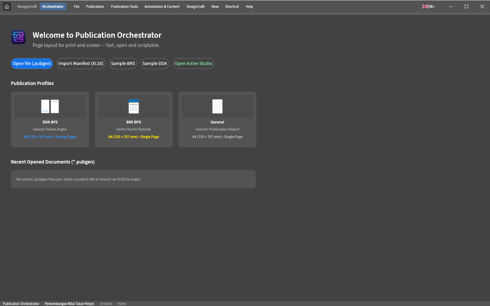
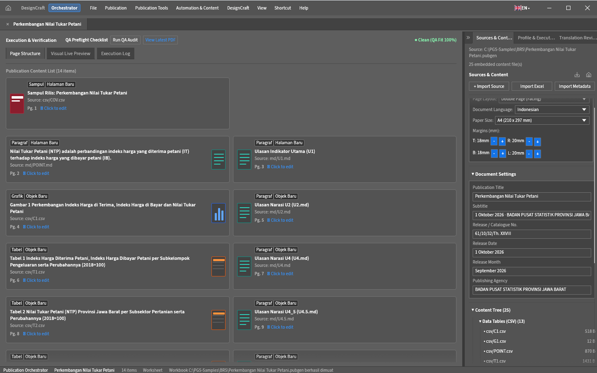

## Antarmuka PubGen Studio

Satu jendela, dua mode. **Orchestrator** adalah beranda dan ruang kerja publikasi: impor buku kerja atau buka paket `.pubgen`, pilih profil, lalu periksa kartu halaman sebelum diterbitkan.

*Beranda **Orchestrator** — kartu profil BPS DDA, BPS BRS, dan General membuka Studio dengan profil tersebut; paket terakhir muncul di daftar Recent Opened Documents.*

*Studio **Orchestrator** — kartu halaman di tab **Page Structure**, strip **QA Preflight Checklist**, dan dock kanan **Sources & Content**. Tombol **Generate Publication** dan **Generate & Publish PDF** ada di tab dock **Profile & Execution**.*

Mulai dari [pengenalan PGS dan kedua modenya](/guide/01-pengenalan), atau langsung ikuti [tutorial praktis](/guide/13-tutorial).
