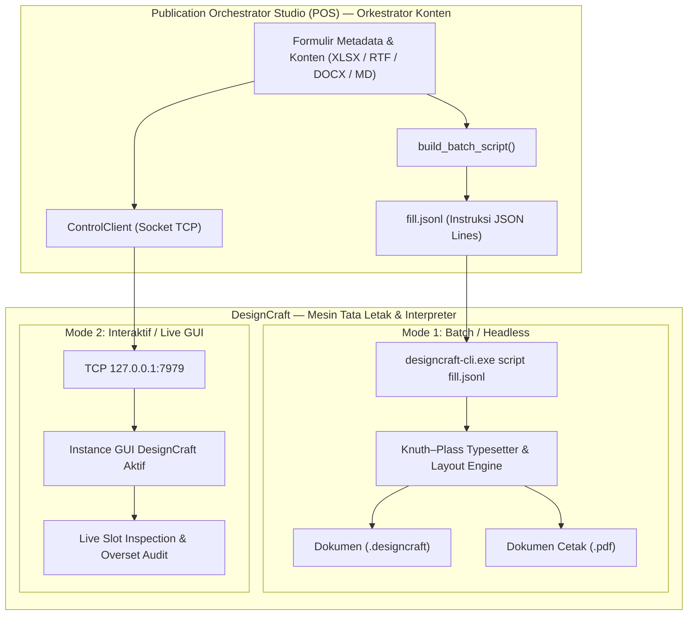
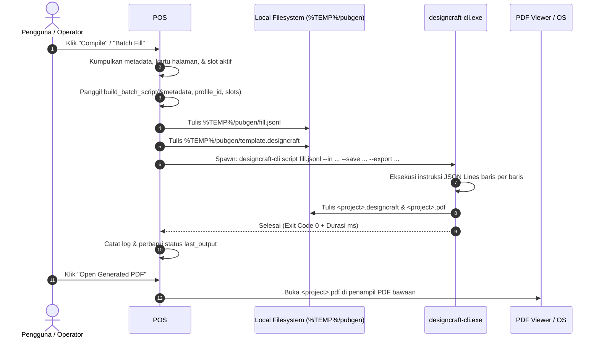

# Alur Pengiriman & Spesifikasi Perintah Interpreter DesignCraft

Dokumen ini mendokumentasikan secara rinci arsitektur integrasi, siklus hidup eksekusi (*lifecycle*), dan spesifikasi muatan perintah (*payload specification*) yang dikirimkan oleh **Publication Orchestrator Studio (POS)** ke mesin tata letak **DesignCraft** (`designcraft-cli` dan `designcraft.exe`).

---

## 1. Prinsip Arsitektur: Clean-Room Decoupling

Integrasi antara POS dan DesignCraft beroperasi dengan prinsip pemisahan tanggung jawab penuh (*separation of concerns*):



1. **POS (Orkestrator & Normalizer):**
   - Mengumpulkan metadata (judul, nomor rilis, tanggal, kontak, dll.).
   - Menormalisasi file sumber (DOCX/RTF $\rightarrow$ Markdown `.md`, XLSX $\rightarrow$ CSV bertingkat).
   - Menghasilkan aset pendukung (grafik vektor SVG murni, peta choropleth tematik GeoJSON).
   - Menyusun berkas skrip instruksi atomik bertipe *JSON Lines* (`fill.jsonl`).
   - **POS tidak pernah membongkar atau memodifikasi file biner `.designcraft` secara langsung.**

2. **DesignCraft (Interpreter & Typesetter):**
   - Membaca baris-baris perintah JSON secara berurutan.
   - Menerapkan algoritma perataan teks Knuth–Plass, pemenggalan kata (*hyphenation*), optical margin alignment, pembuatan frame gambar, dan binding tabel otomatis.
   - Menghasilkan dokumen native `.designcraft` serta mengekspor PDF/X beresolusi tinggi.

---

## 2. Dua Jalur Pengiriman Perintah

### Jalur A: Mode Kompilasi Batch / Headless (`designcraft-cli`)
Mode ini digunakan saat pengguna menekan tombol **`Compile`** di Top Bar, tombol **`Export PDF`** di panel tengah, atau menu **`Publication -> Batch Fill & Bind Document`**.

* **Eksekutabel:** `designcraft-cli.exe`
* **Format Perintah:** Perintah baris perintah (CLI command) dengan argumen:
  ```powershell
  designcraft-cli script <path_to_fill.jsonl> \
    --in <path_to_template.designcraft> \
    --save <path_to_output.designcraft> \
    --export <path_to_output.pdf>
  ```
* **Karakteristik:**
  - Berjalan di latar belakang tanpa membuka jendela antarmuka GUI DesignCraft.
  - Sangat cepat, deterministik, dan cocok untuk pemrosesan publikasi skala besar.

### Jalur B: Mode Interaktif / Live Socket (Port 7979)
Mode ini digunakan saat instance GUI DesignCraft sedang aktif terbuka di komputer pengguna.

* **Protokol:** JSON-RPC over TCP loopback (`127.0.0.1:7979`), *newline-delimited*.
* **Fitur Utama:**
  - `document.inspect`: Memindai seluruh frame bernama `slot:*` pada dokumen yang aktif di layar.
  - `story.setText`: Mengisi atau memperbarui teks pada slot tertentu secara langsung (*live reflection*).
  - `audit.overset`: Memeriksa apakah terjadi teks terpotong (*overset / overflow*) pada frame teks.

---

## 3. Siklus Hidup Eksekusi Perintah (*Execution Lifecycle*)



---

## 4. Spesifikasi Perintah JSON Lines (`fill.jsonl`)

Setiap baris di dalam berkas `fill.jsonl` adalah objek JSON valid yang diakhiri oleh karakter baris baru (`\n`).

### 4.1. Variabel Teks Dokumen (`variables.define`)
Mendefinisikan variabel global dokumen yang dapat disematkan di master page atau halaman dokumen:
```json
{"command": "variables.define", "params": {"name": "Title", "type": "customText", "text": "Kecamatan Karawang Timur Dalam Angka 2026"}}
{"command": "variables.define", "params": {"name": "Release No", "type": "customText", "text": "61/10/32/Th. XXVIII"}}
```

### 4.2. Penerapan Running Header & Running Footer (`layout.headerFooter.apply`)
Menetapkan baris header atau footer otomatis berdasarkan profil publikasi:

* **Profil BPS Berita Resmi Statistik (BRS) — Single Sided Header:**
```json
{
  "command": "layout.headerFooter.apply",
  "params": {
    "preset": "hf-brs",
    "sided": "single",
    "header": {
      "single": "Perkembangan Nilai Tukar Petani Jawa Barat\nNo. 61/10/32/Th. XXVIII, 1 Oktober 2026",
      "left": "Perkembangan Nilai Tukar Petani Jawa Barat\nNo. 61/10/32/Th. XXVIII, 1 Oktober 2026",
      "right": "Perkembangan Nilai Tukar Petani Jawa Barat\nNo. 61/10/32/Th. XXVIII, 1 Oktober 2026"
    }
  }
}
```

* **Profil BPS Daerah Dalam Angka (DDA) — Facing Spreads Footer:**
```json
{
  "command": "layout.headerFooter.apply",
  "params": {
    "preset": "hf-dda",
    "sided": "double",
    "footer": {
      "single": "Kecamatan Karawang Timur Dalam Angka 2026\nKarawang Timur District in Figures 2026",
      "left": "Kecamatan Karawang Timur Dalam Angka 2026\nKarawang Timur District in Figures 2026",
      "right": "Kecamatan Karawang Timur Dalam Angka 2026\nKarawang Timur District in Figures 2026"
    }
  }
}
```

### 4.3. Pemecahan Halaman Dokumen (`layout.pages.insert`)
Disisipkan sebelum konten jika cakupan item disetel sebagai **Halaman Baru** (`NewPage`):
```json
{"command": "layout.pages.insert", "params": {"count": 1}}
```
*(Jika cakupan item disetel sebagai **Objek Baru** (`NewObject`), perintah ini tidak dibuat sehingga konten disematkan berurutan di halaman aktif)*.

### 4.4. Penerapan Template Sampul (`template.apply`)
Memuat preset tata letak halaman sampul:
```json
{"command": "template.apply", "params": {"path": "assets/templates/covers/brs/brs.designcraft"}}
```

### 4.5. Penempatan Gambar Sampul & Logo (`object.place`)
Menempatkan berkas visual ke dalam frame slot gambar sampul:
```json
{"command": "object.place", "params": {"slot": "slot:image:hero", "path": "samples/brs/theme1.png"}}
{"command": "object.place", "params": {"slot": "slot:image:logo", "path": "samples/images/bps_logo.png"}}
{"command": "object.place", "params": {"slot": "slot:image:qr", "path": "samples/brs/qr61.png"}}
```

### 4.6. Penulisan Teks Sorotan & Narasi (`story.setText`)
Memasukkan teks langsung atau memuat teks narasi dari file Markdown terkonversi:
```json
{"command": "story.setText", "params": {"slot": "slot:text:highlight", "text": "NTP Jawa Barat September 2026 sebesar 112,45 atau naik 0,99 persen"}}
{
  "command": "story.setText",
  "params": {
    "source": "md/U1.md",
    "title": "Ulasan Narasi Perkembangan NTP",
    "title_en": "Narrative Review of Farmer Terms of Trade",
    "chapter": "1"
  }
}
```

### 4.7. Penyisipan Tabel Data Statistik (`table.insert`)
Menyisipkan tabel data tabular dari berkas CSV dengan konvensi styling BPS:
```json
{
  "command": "table.insert",
  "params": {
    "source": "samples/brs/csv/ntp202610-1.csv",
    "title": "Tabel 1 Perkembangan Nilai Tukar Petani Menurut Subsektor",
    "title_en": "Table 1 Farmer Terms of Trade by Subsector",
    "chapter": "1",
    "first_row_header": true,
    "col_numbers": true,
    "table_footer": false
  }
}
```
* **`first_row_header`**: Baris pertama CSV menjadi header kolom.
* **`col_numbers`**: Menyisipkan baris penomoran kolom `(1) (2) (3)...` standar publikasi BPS.
* **`table_footer`**: Menambahkan catatan kaki dan sumber data di bawah tabel.

### 4.8. Penyisipan Grafik Vektor Statistik (`paste.svg`)
Menyisipkan grafik vektor SVG (hasil generate POS atau file eksternal):
```json
{
  "command": "paste.svg",
  "params": {
    "source": "samples/brs/csv/C1_line.csv",
    "title": "Grafik 1 Perkembangan NTP Jawa Barat Januari - September 2026",
    "title_en": "Figure 1 Trend of Farmer Terms of Trade January - September 2026",
    "chart_type": "Line Chart"
  }
}
```

### 4.9. Pembuatan Frame Gambar / Infografis (`frame.create`)
Menyisipkan gambar visual atau infografis dengan pilihan area penempatan:
```json
{
  "command": "frame.create",
  "params": {
    "content": "image",
    "source": "samples/brs/G1.png",
    "title": "Infografis Ringkasan NTP",
    "area": "margin"
  }
}
```
* **`area`**: `"margin"` (mengikuti batas margin halaman) atau `"full_page"` (halaman penuh / bleed tanpa margin).

### 4.10. Pengisian Frame Teks Spesifik Berdasarkan ID Story
Mengisi frame teks spesifik pada template berdasarkan ID unik story:
```json
{"command": "story.setText", "params": {"story": 21, "text": "Teks ulasan ringkas hasil komputasi"}}
```

---

## 5. Ringkasan Parameter Utama Berdasarkan Profil Publikasi

| Fitur / Parameter | Profil BPS DDA (*Daerah Dalam Angka*) | Profil BPS BRS (*Berita Resmi Statistik*) |
| :--- | :--- | :--- |
| **Geometri Halaman** | A4 (210 × 297 mm), *Facing Spreads* | A4 (210 × 297 mm), *Single Page* |
| **Running Header/Footer** | Running Footer Dwibahasa (`hf-dda`) | Running Header Nomor Rilis & Tanggal (`hf-brs`) |
| **Default Cakupan Sheet Excel** | Semua sheet default **Halaman Baru** (`NewPage`) | `COV`/`POINT`/`U1` = **Halaman Baru**, sheet lainnya = **Objek Baru** (`NewObject`) |
| **Styling Tabel Data** | Header kolom dwibahasa + footer sumber | Penomoran kolom `(1)(2)...` + tanpa footer tabel |
| **Preset Sampul** | Modern Horizon (`007_modern_horizon.designcraft`) | Sampul Resmi BRS (`brs/brs.designcraft`) |
| **Area Gambar Default** | Area Margin | Area Margin |

---

## 6. Verifikasi & Pengujian Otomatis

Implementasi pembentukan skrip dan pengiriman perintah ini dilindungi oleh pengujian unit otomatis di [`app/src/panels.rs`](file:///f:/GitHub/designcraft-pubgen/pubgen/app/src/panels.rs):
- `test_build_batch_script_dda`: Memverifikasi pembuatan perintah footer DDA, variabel teks, dan story replacement.
- `test_build_batch_script_brs`: Memverifikasi pembuatan perintah header BRS, nomor rilis resmi, dan tanggal.
- `test_build_batch_script_pages_and_tables`: Memverifikasi perintah penempatan aset sampul (`slot:image:hero`, `slot:image:logo`, `slot:text:highlight`), `table.insert`, dan `paste.svg`.
- Seluruh 61 pengujian otomatis lulus 100% (`cargo test`).

