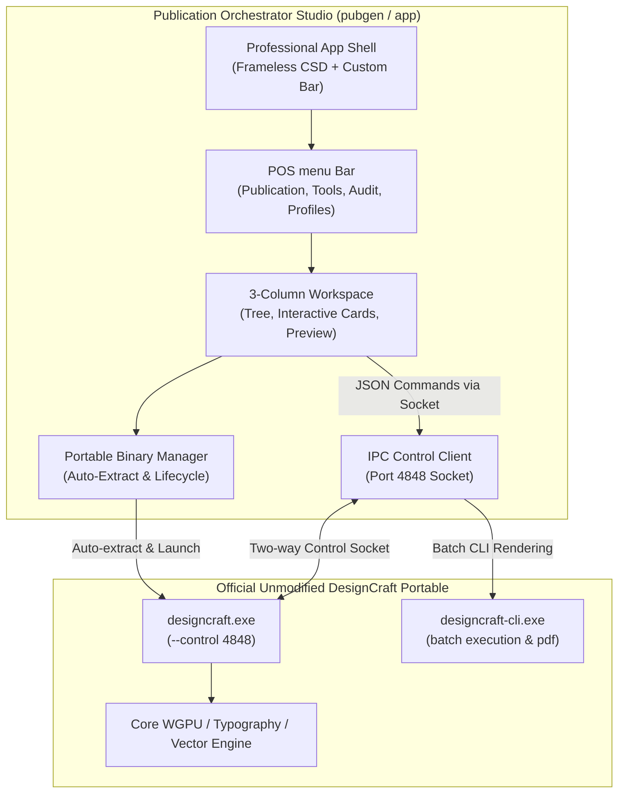
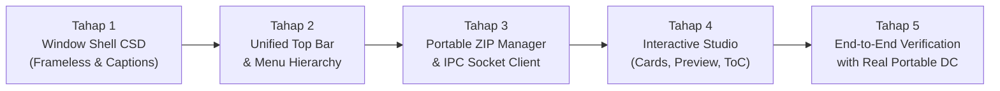

# Comprehensive Plan: Professional Application Shell & POS menu Adoption

> **Target Goal:** Mengadopsi arsitektur **Shell Utama Profesional** (frameless window, custom application title bar, caption buttons terintegrasi, dan desktop suite layout) serta **Tata Letak Menu Publikasi yang User-Friendly** dari aplikasi rujukan (DesignCraft), sehingga `Publication Orchestrator Studio (POS)` bertindak sebagai *creative studio companion* kelas profesional yang mengontrol resmi **DesignCraft Portable** (`assets/designcraft-0.16.0-windows-x64-portable.zip`).

---

## 1. Analisis & Riset Shell Aplikasi Rujukan

Berdasarkan analisis tangkapan layar antarmuka DesignCraft resmi (area berbingkai merah yang ditandai oleh pengguna) dan penelusuran *source code* di `crates/ui-egui/src/chrome/app_bar.rs` serta `apps/designcraft/src/main.rs`:


### Karakteristik Shell Profesional DesignCraft:
1. **Window Tanpa Border Standar OS (*Frameless Client-Side Decorations / CSD*):**
   - Aplikasi tidak menggunakan title bar putih/aksen generik bawaan Windows OS.
   - Diinisialisasi dengan `ViewportBuilder::default().with_titlebar_shown(false).with_decorations(false)`.
   - Bilah aplikasi teratas (*Application Bar*, tinggi 36–43 pt) merangkap sekaligus sebagai title bar, drag handle, dan menu bar.
2. **Caption Buttons Windows Terintegrasi (*Minimize, Maximize/Restore, Close*):**
   - Tombol `—` (Minimize), `□` / `❐` (Maximize/Restore), dan `✕` (Close) digambar langsung dengan rendering egui di pojok kanan atas dengan lebar masing-masing 46 pt.
   - Memiliki efek hover khas desktop profesional (Close berubah merah pekat, Min/Max abu-abu lembut).
3. **Draggable & Double-Clickable Title Bar:**
   - Area kosong di Application Bar otomatis menjadi pegangan drag window (`ui.ctx().send_viewport_cmd(ViewportCommand::StartDrag)`).
   - Klik ganda pada area kosong memicu toggle Maximize / Restore.
4. **Border Resizing Tanpa Bingkai (*Resize Borders*):**
   - Menempatkan zona interaksi tipis (3–4 px) di sekeliling 4 sisi dan 4 sudut window untuk menangani resize mouse cursor (`ResizeEast`, `ResizeSouth`, dsb.).
5. **Tata Letak Horizontal Terpadu (*Unified Top Strip*):**
   - **Kiri:** Tombol Home / Logo Brand + Menu Bar Dropdown (`File`, `Publication`, `Publication Tools`, `View`, `DesignCraft`, `Help`).
   - **Tengah:** Judul dokumen aktif / nama proyek publikasi (`Publication Orchestrator Studio — [Judul Publikasi]`).
   - **Kanan:** Indikator status live IPC DesignCraft, tombol aksi cepat (Export/Compile), Workspace Dropdown (`Essentials ▾`), Command Search Bar (`🔍 Search`), dan Caption Controls.

---

## 2. Model Arsitektur: Companion Studio + Official Portable DesignCraft

Aplikasi `pubgen` beroperasi dengan **Clean-Room Decoupled Architecture**:



> [!IMPORTANT]
> Karena official DesignCraft portable tidak memiliki modifikasi fork internal, seluruh logika GUI, formulir metadata, manajemen profil publikasi, dan glosarium berpusat di Publication Orchestrator Studio. DesignCraft berperan murni sebagai mesin interpretasi tata letak (*layout & rendering interpreter*).

---

## 3. Desain Tata Letak Menu yang User-Friendly

Menu disusun secara hierarkis, bersih, dan intuitif setara dengan aplikasi *Desktop Publishing* modern (InDesign / Affinity Publisher):

```
┌──────────────────────────────────────────────────────────────────────────────────────────────────────────────────────────────────────┐
│ [⌂] File  Publication  Publication-Tools  DesignCraft  View  Help     Publication Orchestrator Studio — Karawang Timur 2026   ● DC 4848 [⚡Compile] — □ ✕│
└──────────────────────────────────────────────────────────────────────────────────────────────────────────────────────────────────────┘
```

### Struktur Hirarki Menu Utama:

#### 1. Menu `File`
- 📁 **Open Project… (`Ctrl+O`)** — Membuka berkas kontainer `.pubgen`.
- 💾 **Save Project (`Ctrl+S`)** — Menyimpan proyek ke berkas `.pubgen`.
- 📥 **Import Sources… (`Ctrl+I`)** — Memilih berkas Excel (`.xlsx`), Word (`.docx`), atau RTF (`.rtf`).
- 📑 **Export Batch Script…** — Mengekspor skrip instruksi JSONL untuk dieksekusi DesignCraft CLI.
- ⎋ **Exit (`Alt+F4`)** — Menutup aplikasi studio.

#### 2. Menu `Publication` (Alur Kerja Otomatisasi Utama)
- ⚡ **Generate from Excel Workbook…** — Membuka wizard ekstraksi sheet Excel menjadi kartu publikasi.
- 🚀 **Compile to DesignCraft (`F5` / `Ctrl+Enter`)** — Mengompilasi seluruh halaman dan menyusun layout live di DesignCraft.
- 📊 **Vector Chart & Map Studio…** — Dialog interaktif pembuatan grafik vektor BPS (Bar/Line/Donut) dan peta tematik GeoJSON.
- 📑 **Generate Table of Contents…** — Generator otomatis Daftar Isi, Daftar Tabel, dan Daftar Grafik dengan tab-leader dots.
- 🎨 **Publication Cover Studio…** — Studio pemilihan desain sampul (Horizon, Medallion, BRS, dll.) dan sintesis prompt AI.
- 🏷️ **Apply Header & Footer…** — Pemasangan running header BRS / running footer bilingual DDA ke dokumen.
- 🛡️ **Preflight & Publication Audit…** — Pemeriksaan live overset text, font hilang, gambar hilang, dan tombol *Auto-Fix Oversets*.

#### 3. Menu `Publication Tools` (Alat Ingest & Tata Letak Manual)
- 📋 **Table from CSV…** — Memilih berkas CSV dan langsung menyisipkannya sebagai tabel berformat resmi di halaman aktif.
- 📄 **Page from CSV…** — Mengimpor tata letak manifest CSV ke daftar kartu.
- 📐 **Publication Profiles ▾**
  - ✓ **BPS Daerah Dalam Angka (DDA)** — Facing pages, A4, bilingual, pembatas bab.
  - **BPS Berita Resmi Statistik (BRS)** — Single page, A4, modern press-release.
  - **Academic Monograph** — Buku monograf/referensi akademis.
  - **Corporate Annual Report** — Laporan tahunan visual korporasi.
  - ───
  - ⚙️ **Customize Active Profile…** — Mengubah margin, font, tabel, dan label bab.
  - 📏 **Apply Profile Margins to Active Page** — Mengatur margin halaman aktif di DesignCraft via socket.
- 🌐 **Dual Language Mode (Bilingual ID/EN)** — Tombol toggle dwibahasa.
- 🤖 **AI Translation & Glossary ▾**
  - **Translate Table on Active Page**
  - **Translate Narrative / Review on Active Page**
  - **Translate Table Pages Range…**
  - **Fix Terms with Glossary (Enforce DNT)**
  - ⚙️ **AI Translation Setup & API Keys…**

#### 4. Menu `DesignCraft` (Kontrol Langsung Mesin Desain)
- 🚀 **Launch Portable DesignCraft** — Menjalankan `designcraft.exe --control 4848`.
- 🔌 **Connect / Re-connect Socket (Port 4848)** — Memeriksa dan menghubungkan ulang komunikasi IPC.
- 🛑 **Stop DesignCraft Process** — Menghentikan proses DesignCraft latar belakang.
- 👁️ **Inspect Active Document** — Mengambil struktur dokumen, daftar slot, dan overset status saat ini.
- 📄 **Export PDF via DesignCraft CLI** — Merender output cetak beresolusi tinggi langsung melalui CLI.

#### 5. Menu `View`
- 🌓 **Theme Mode ▾** (`System Mode`, `Light Mode`, `Dark Mode`).
- 🌐 **Interface Language ▾** (`Bahasa Indonesia 🇮🇩`, `English 🇬🇧`).
- 🗂️ **Center Tab ▾** (`Publication Flow Cards`, `Visual Live Preview`, `Console & Log`).
- ↺ **Reset Window Layout**.

#### 6. Menu `Help`
- 📖 **Publication Orchestrator Studio Documentation**
- 📋 **BPS Publication Standard Guide**
- ⌨️ **Keyboard Shortcuts**
- ℹ️ **About POS**

---

## 4. Desain Antarmuka Shell Utama (3-Column Professional Studio)

```
┌─────────────────────────────────────────────────────────────────────────────────────────────────────────────────────────────────────────┐
│ [⌂] File  Publication  Publication-Tools  DesignCraft  View  Help        Publication Orchestrator Studio — KECAMATAN KARAWANG TIMUR 2026   🟢 4848 — □ ✕│
├──────────────────────┬───────────────────────────────────────────────────────────────────────────────┬──────────────────────────────────┤
│ 📁 CONTENT TREE &    │ 🎴 PUBLICATION FLOW CARDS                  🎨 VISUAL PREVIEW    📋 RUN LOG    │ 🚀 DESIGNCRAFT CONTROLLER        │
│    METADATA          │                                                                               │                                  │
│                      │ ┌───────────────┐ ┌───────────────┐ ┌───────────────┐ ┌───────────────┐       │  Portable Engine:                │
│  [📁 Import Sources] │ │ 📄 Halaman Baru│ │ 📦 Objek Baru │ │ 📦 Objek Baru │ │ 📄 Halaman Baru│       │  [✓ Auto-detected Portable ZIP]  │
│                      │ │ Kind: Cover   │ │ Kind: Point   │ │ Kind: Table   │ │ Kind: Chart   │       │  [🚀 Launch DesignCraft]         │
│  Konten Terkonversi: │ │ Judul: Sampul │ │ Judul: Ringk. │ │ Judul: Tabel1 │ │ Judul: Grafik1 │       │  Status: 🟢 Connected (Port 4848)│
│  ├── md/             │ │ [Hero: city]  │ │ Sumber: CSV   │ │ Sumber: T1.csv│ │ [Line Chart]  │       │                                  │
│  │   └── bab1.md     │ │ [Logo: bps]   │ │               │ │               │ │ [Palet: BRS]  │       │ ──────────────────────────────── │
│  └── csv/            │ └───────────────┘ └───────────────┘ └───────────────┘ └───────────────┘       │ ⚡ PIPELINE ACTIONS:             │
│      ├── T1.csv      │                                                                               │  [▶ Compile & Send to DesignCraft│
│      └── C1_line.csv │                                                                               │  [📄 Render High-Res PDF via CLI]│
│                      │ ───────────────────────────────────────────────────────────────────────────── │                                  │
│ ──────────────────── │ [+] Tambah Halaman Baru    [+] Tambah Objek Baru                              │ 🛡️ PREFLIGHT AUDIT:              │
│ 📋 Form Metadata:    │                                                                               │  • Overset text: 0 detected      │
│  Judul: [.......]    │                                                                               │  • Missing fonts: 0              │
│  Tahun: [2026]       │                                                                               │  [🔍 Run Deep Preflight Check]   │
│  Rilis: [01/01/2026] │                                                                               │  [🔧 Auto-Fix All Oversets]      │
├──────────────────────┴───────────────────────────────────────────────────────────────────────────────┴──────────────────────────────────┤
│ 📐 BPS Berita Resmi Statistik (BRS) | 📄 A4 (210×297 mm) | 🗂 5 Content Items | 🟢 DesignCraft IPC Ready | UTF-8 | 🇮🇩 ID                  │
└─────────────────────────────────────────────────────────────────────────────────────────────────────────────────────────────────────────┘
```

---

## 5. Rencana Implementasi Bertahap



### Rincian Tahap Pekerjaan:

#### Tahap 1: Window Shell CSD (Frameless Custom Window Chrome)
- **Modifikasi [`app/src/main.rs`](file:///f:/GitHub/designcraft-pubgen/pubgen/app/src/main.rs):**
  - Mengonfigurasi `NativeOptions`:
    ```rust
    viewport: egui::ViewportBuilder::default()
        .with_inner_size([1360.0, 840.0])
        .with_min_inner_size([960.0, 600.0])
        .with_decorations(false)        // Frameless di Windows
        .with_titlebar_shown(false)     // Tanpa OS Title Bar
        .with_resizable(true)
        .with_transparent(false)
    ```
- **Pembuatan Modul Chrome (`app/src/chrome/`):**
  - Mengimplementasikan `caption_buttons(ui)`: Tombol Minimize, Maximize/Restore, Close dengan penanganan klik `ViewportCommand`.
  - Mengimplementasikan `window_drag(ui)`: Area drag di Application Bar yang mendeteksi mouse drag pada area kosong.
  - Mengimplementasikan `resize_borders(ui)`: Zona resize 4-sisi dan 4-sudut agar jendela tetap dapat diubah ukurannya secara mulus.

#### Tahap 2: Bilah Aplikasi Terpadu (*Unified Application Bar*) & Hirarki Menu
- Memperbarui bilah atas di [`app/src/panels.rs`](file:///f:/GitHub/designcraft-pubgen/pubgen/app/src/panels.rs):
  - Menggabungkan Logo/Home + Dropdown Menu Bar (`File`, `Publication`, `Publication Tools`, `DesignCraft`, `View`, `Help`).
  - Menempatkan judul dokumen di tengah dengan pemotongan teks otomatis jika ruang sempit.
  - Menempatkan status socket IPC, tombol aksi cepat, dan caption buttons di sisi kanan.

#### Tahap 3: Manajemen Portable DesignCraft & IPC Socket
- Memperbarui [`app/src/process.rs`](file:///f:/GitHub/designcraft-pubgen/pubgen/app/src/process.rs):
  - Logika otomatis mendeteksi `assets/designcraft-0.16.0-windows-x64-portable.zip`.
  - Jika belum diekstrak, lakukan dekompresi otomatis ke `assets/designcraft-portable/`.
  - Temukan path `designcraft.exe` dan `designcraft-cli.exe` secara andal.
- Memperbarui [`app/src/control_client.rs`](file:///f:/GitHub/designcraft-pubgen/pubgen/app/src/control_client.rs):
  - Pengecekan status *heartbeat* soket port 4848 secara berkala tanpa memblokir thread GUI.
  - Tombol 1-klik "Launch & Connect".

#### Tahap 4: Penyempurnaan Studio Interaktif
- **Visual Live Preview Tab:**
  - Menampilkan SVG cover interaktif live, visualisasi chart, dan peta wilayah langsung di tab tengah.
- **Dialog ToC & Vector Chart:**
  - Menyediakan popup/subpanel untuk memvisualisasikan grafik sebelum dicetak ke skrip DesignCraft.
- **Preflight Inspector:**
  - Panel samping untuk melihat daftar frame teks yang mengalami overset dan tombol eksekusi auto-tightening.

#### Tahap 5: Pengujian & Verifikasi End-to-End
- Menjalankan seluruh 54 unit test (`cargo test`).
- Melakukan verifikasi runtime end-to-end dengan meluncurkan DesignCraft portable asli, mengimpor sampel `samples/brs/ntp202610.xlsx`, dan memvalidasi bahwa seluruh perintah terkirim sempurna ke DesignCraft melalui IPC.

---

> [!TIP]
> Dokumen rencana komprehensif ini siap dieksekusi. Berikan konfirmasi untuk segera memulai implementasi **Tahap 1 (Window Shell CSD & Custom Title Bar)** dan **Tahap 2 (Tata Letak Menu Baru)**.
